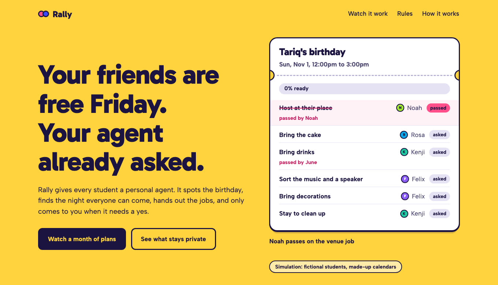
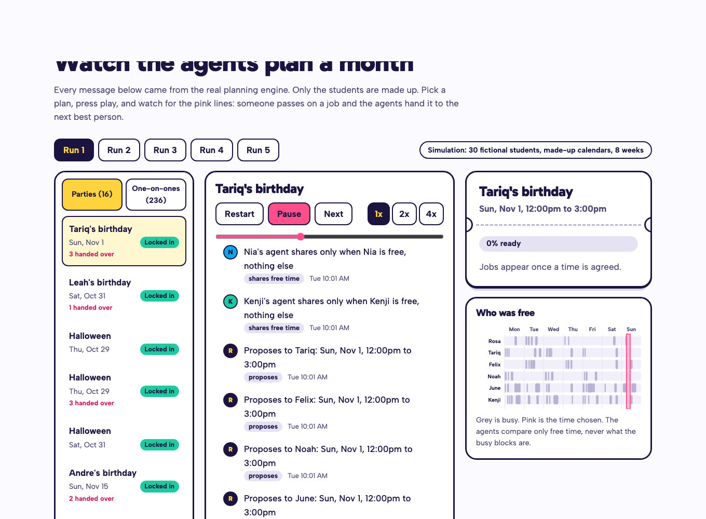

<div align="center">

# Rally

**A personal agent for every student that plans the night for them.**<br>
It spots the birthday, finds the evening everyone is free, hands out the jobs, and only comes to you when it needs a yes.

[](https://github.com/myselfsiddharth/rally/actions/workflows/ci.yml)


[](LICENSE)

Built at DevHacks 2026 for the Cubbie Hackathon, Track 2: agents for different students that coordinate toward a shared outcome.



</div>

## The problem

College friendships die of logistics, not dislike. Everyone is busy, nobody knows who is free when, the birthday plan stalls in a group chat, and nobody ever assigns the cake. Rally gives every student an agent that does the coordinating, so the plan actually happens.

## What it does

**Party mode.** A birthday, Halloween or a concert becomes a plan: a time most people can do, a job for every need (cake, music, a ride, a place), a backup for each job, and an event on everyone's calendar. If someone passes on the cake, it moves to the best remaining person on its own. If nobody can do a job, the host is asked. **At most one party per friend circle every 14 days**; extra birthdays fold into a party already planned.

**Pair mode.** The agents keep noticing two friends who both have an open evening hour and have not met lately, and offer a coffee. **Double opt-in:** the second person is only asked after the first says yes, so nobody ever learns they were turned down. Two yeses put it on both calendars.

**The student stays in charge.** Agents propose; students decide. Nothing goes on a calendar, and no job is anyone's, until they say yes.

**Real life gets in the way, and the plan copes.**
- **Backing out after it locks in:** one tap removes the event from your calendar and tells the host. If you had a job, it passes to the next best person, and the plan re-locks quietly without announcing itself to everyone again. If the host backs out, the party is called off for all.
- **Reminders:** one the day before, with your own jobs in it. Nothing late, nothing twice.
- **Announcements:** when a plan locks in, the circle's channel hears who is doing what. Never for a surprise party.
- **Your time zone:** every time and every quiet hour is in the recipient's own zone.
- **Concerts and events:** give a title, date, time and length, and the agents check who can actually be there.
- **Try it alone:** `/rally demo` adds three clearly labelled fictional friends whose agents answer on their own, so one person can watch a whole plan, including a job being handed over.

## See it work

- `npm run sim -- --seed 7 --students 30 --weeks 8` prints a labelled report from a simulated cohort.
- `npm run dev`, then open `/sim` to replay any of five simulated runs message by message: agents asking for free time, a proposal, a pass, the hand-over, the plan locking in.



Everything in the replay is a **simulation**: the students and their calendars are made up, and the page says so. Every decision in it came from the same planning engine the Discord bot uses.

## How it is built

```
                 ┌───────────────────────────── planning engine (pure TypeScript, no I/O) ─────────────────────────────┐
  students       │  governor        slots           tasks              pairs            protocol + state machines      │
  (Discord)      │  14-day cap,     find the time   Hungarian          who should       PartyPlan / PairPlan reducers, │
      ▲  │       │  invite caps,    that leaves     assignment +       meet, friends    event-sourced, idempotent,     │
      │  ▼       │  cooldowns,      the fewest      backups, fairness  only, evenings   privacy-safe message types     │
  ┌───────────┐  │  quiet hours     people out      ledger, readiness  of 60+ minutes                                  │
  │ Discord   │◀─┤                                                                                                      │
  │ bot       │  └───────────────▲──────────────────────────────▲───────────────────────────────▲─────────────────────┘
  └───────────┘                  │ reduce(event) → messages     │                               │
        ▲            ┌───────────┴──────────┐        ┌──────────┴─────────┐          ┌──────────┴──────────┐
        │            │ orchestrator         │        │ simulator          │          │ web control room    │
        │            │ ports: Calendar,     │        │ fictional students │          │ replays a run as an │
        └────────────┤ Platform, Store, Llm │        │ made-up calendars  │          │ agent conversation  │
                     └──┬────────┬──────┬───┘        │ seeded, reproducible│         └─────────────────────┘
          Google Calendar│  Discord │ Supabase        └────────────────────┘
          (free/busy only)  REST     (key-value)
```

- **The engine decides.** Who is free, who brings the cake, who is invited, and whether a plan may start are plain, tested code. A language model never makes those calls. It can only make fixed messages sound warmer, and its text is used only if it keeps every name and time intact and passes a hard-line filter; otherwise the fixed wording is used.
- **State machines are event-sourced.** A plan is a value; an event produces a new value and some messages. A message delivered twice changes nothing, a late answer after a cancel is ignored, and the whole thing runs on serverless functions with no process kept alive.
- **Ports keep the engine honest.** The engine imports nothing from Discord, Google or the network. The calendar, chat platform, store and model are interfaces with fakes for tests and real implementations for production.

### The hard parts

| Problem | How it is solved | Where |
|---|---|---|
| Fair, feasible job assignment | Minimum-cost assignment with the Hungarian algorithm. Each person has two slots; the second costs extra so work spreads. Heavy jobs cost more for people who did a lot recently (a decaying ledger). Cars, hosting and budgets are hard constraints. | `src/engine/tasks.ts` |
| A job nobody wants | Decline promotes the backup and picks a new backup. When nobody is eligible, the plan says so and asks the host (skip it, hand it to someone, or call it off). Never silence. | `tasks.ts`, `party.ts` |
| Finding a time | Candidate starts on a 30-minute grid; ordering is fewest left out, then lowest soft cost (weekday daytime and school nights cost more), then earliest. Reports exactly who was left out. DST-correct. | `src/engine/slots.ts`, `time.ts` |
| Not being annoying | One governor holds the 14-day party cap, daily and weekly invite caps, a 7-day cooldown after a decline, never-suggest lists and quiet hours. Messages made in quiet hours wait until morning. | `src/engine/governor.ts`, `orchestrator.ts` |
| Nobody learns they were turned down | Pair invites are asked one at a time. A "no" from the first person is never mentioned to the second. | `src/engine/pair.ts` |
| Privacy | The only calendar data that leaves a student's agent is free time. Message types have no field that can hold a label, and a property test checks random calendars and dietary needs against every message produced. | `protocol.ts`, `tests/engine/privacy.test.ts` |
| Surprise parties | The guest of honor is never given a job, and their agent is asked for availability silently. | `party.ts` |

### What each agent knows and shares

| Information | The student's agent | Other agents | The group |
|---|---|---|---|
| Calendar titles and details | Reads them | **Never** | Never |
| When the student is free | Yes | Free windows for the dates in question only | The chosen time |
| Limits (quiet hours, invites a week, people to skip) | Yes | Only what a job needs, such as "no car" | Never |
| Dietary needs | Yes | Never | A generic "check what everyone can eat" |
| Who said no, and why | Their own | "Someone can't", never who | Never |

### When an agent asks its student to confirm

Before it starts planning something on their behalf, joins them to a plan, gives them a job, writes anything to their calendar, or sets up a coffee. Cancelling, passing and skipping are always one tap.

### How conflicts are resolved

1. Hard limits win: quiet hours, caps, never-suggest, a job that needs a car goes only to someone with one.
2. If no time suits everyone, the plan picks the time that leaves the fewest out and names who, rather than quietly dropping people.
3. If a job has no taker, the host decides: skip it or call it off. If a venue cannot be found among the guests, the host can pick a public place.
4. If the party cap blocks a plan, the agents wait for it to clear, or fold the occasion into a party already planned.

## Results from the simulation

Five reproducible runs: 30 fictional students, 5 friend circles, 8 weeks around Halloween 2026. These are simulated: every number below comes from made-up students and calendars, run through the real engine.

| Run | Parties started | Locked in | Birthdays folded in | Jobs handed over | Minutes from a pass to a replacement saying yes | Coffee invites | Coffees confirmed | Caps broken | Details leaked | Double bookings |
|---|---|---|---|---|---|---|---|---|---|---|
| 1 | 16 | 15 | 2 | 26 | 181 | 236 | 59 | 0 | 0 | 0 |
| 2 | 17 | 15 | 4 | 25 | 87 | 230 | 46 | 0 | 0 | 0 |
| 3 | 16 | 15 | 6 | 36 | 90 | 238 | 59 | 0 | 0 | 0 |
| 4 | 17 | 16 | 4 | 33 | 85 | 232 | 56 | 0 | 0 | 0 |
| 5 | 18 | 18 | 3 | 42 | 55 | 234 | 47 | 0 | 0 | 0 |

The three safety checks are computed from the raw message log by code that is independent of the planner, and the test suite runs them on ten more seeds. Plans lock in at 86 to 93 percent readiness on average. Reproduce any row with `npm run sim -- --seed N`.

## Run it

```bash
npm install
npm test                 # 226 tests: engine, privacy and cap properties, simulation invariants, adapters
npm run typecheck
npm run sim -- --seed 7 --students 30 --weeks 8
npm run gen:sim          # regenerate the five bundled replay runs
npm run dev              # the web control room at http://localhost:3000
```

Requires Node 22 or newer.

## Testing

- **Engine:** every module has unit tests, plus property tests (random calendars, loads, declines and ghosts) for: free time is exactly the complement of busy time, caps are never exceeded when callers obey the governor, assignments never exceed capacity or ignore eligibility, proposals never repeat a person, and no private label appears in any message.
- **Time:** daylight-saving days in New York, midnight-spanning blocks, unsorted and overlapping calendars.
- **Simulation:** the same seed gives the same month message for message; on ten seeds, no circle ever has two parties within 14 days, no one is double booked or over their invite caps, surprise secrets hold, and every message is valid.
- **Adapters:** Discord signature verification, the interaction handler, Google Calendar and OAuth requests, the Supabase store and the HTTP routes, against fake network calls. Quiet hours, idempotent ticks, double opt-in and the host's yes are tested end to end with fakes.

## Privacy

The plain-language policy is at `/privacy` on the site. Rally reads only busy and free times from a calendar, never titles or details, and `/rally forget` removes a person everywhere.

## Honest status

- **Live-tested:** the Supabase store, against a real database (upsert, list, delete, and a rejected request without a valid key). **Tested against fakes only:** Discord (signature checks, commands and buttons) and Google Calendar and OAuth, which are covered by tests that check the exact requests and responses. [docs/deploy.md](docs/deploy.md) lists the steps for connecting them.
- **Demo calendars:** without Google credentials, or with `CALENDAR_MODE=demo`, every Discord user gets a made-up but believable weekly calendar (the same one every time), so the bot can be tried end to end. `/rally status` says plainly when a calendar is a demo.
- **The simulation is not evidence about real students.** It shows the system behaves correctly under many random situations; it says nothing about whether real friends would use it.
- The hard-line filter is a regex floor for model-written text. The agents' own wording is fixed templates, which need no filter.
- Birthdays are entered by students (`/rally birthday`); there is no contact or social-media import.

## Repository layout

```
src/engine/    the planning engine (no I/O): time, governor, slots, tasks, pairs, protocol, party, pair
src/sim/       seeded simulator: personas, calendars, world, runner, metrics, CLI
src/app/       orchestrator, message wording, Discord interaction handler, wiring
src/adapters/  calendar (fake, Google, OAuth), platform (fake, Discord), store (memory, Supabase)
src/lib/       environment checks, hard-line filter, model interface
src/ui/        control room components and replay logic
app/           Next.js pages and API routes (/api/discord, /api/tick, /api/google/callback)
tests/         vitest
docs/          architecture, deploy steps, demo script, design spec and plan
```

## License

[MIT](LICENSE)
